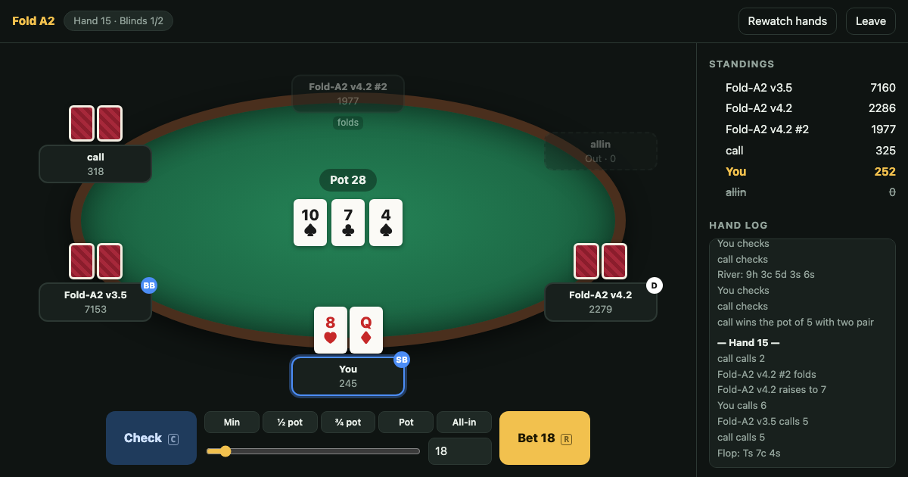

# Fold A2 Poker Room

Play no-limit Texas hold'em in your browser against the poker bots our team built for the MAC Poker Bot Hackathon
at Monash. Solo or with friends, 5 to 8 players, knockout or tournament format, and you can rewatch every hand.

<!-- add the live demo link here once it is deployed -->



## Run it on your own computer

You need Python 3.10 or newer.

```bash
git clone https://github.com/PeterT1665/Fold-A2.git
cd Fold-A2

python3 -m venv .venv
source .venv/bin/activate            # on Windows: .venv\Scripts\activate
pip install play/vendor/macpoker-0.1.0-py3-none-any.whl

python play/server.py
```

Then open http://localhost:8000.

With Docker instead: `docker build -t fold-a2-poker . && docker run -p 8000:10000 fold-a2-poker`, then open
http://localhost:8000.

## What you can do

- **Knockout (normal poker):** stacks carry over, the dealer button and blinds move round the table, blinds go up
  over time, and the last player with chips wins.
- **MAC tournament format:** the hackathon's rules, where 200-chip stacks reset every hand and seats rotate. Most
  chips after N hands wins.
- **Opponents:** Fold-A2 v4.2 (our tournament entry), v3.5 (the bot before it), and the organisers' house bots.
- **Multiplayer:** host a table, share the invite link, and friends join from their own browsers. Open seats are
  filled by the bot.
- **Rewatch:** step through any finished hand action by action.

## About the bot

Fold-A2 v4.2 keeps track of every hand an opponent could hold and narrows it down with each action they take, using
how bots on the hackathon's practice ladder actually behaved. It then picks whichever action wins the most chips on
average. Details are in [play/README.md](play/README.md); the tests are in `play/tests/`.

## Notes

- Built on the hackathon's `macpoker` SDK (vendored in `play/vendor/`; its package metadata declares the MIT licence).
  This is an unofficial fan project, not run or endorsed by the organisers.
- Hosting it for other people: see [play/DEPLOY.md](play/DEPLOY.md).
